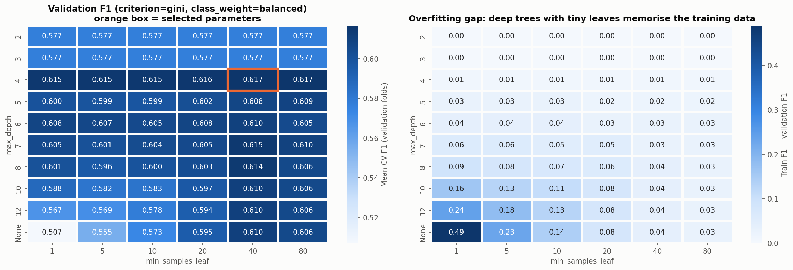
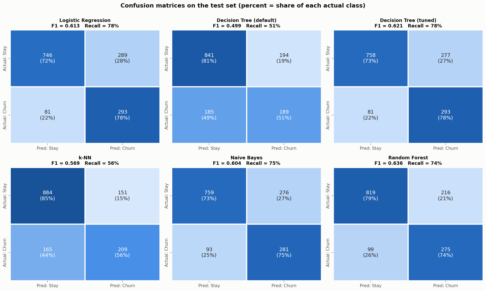
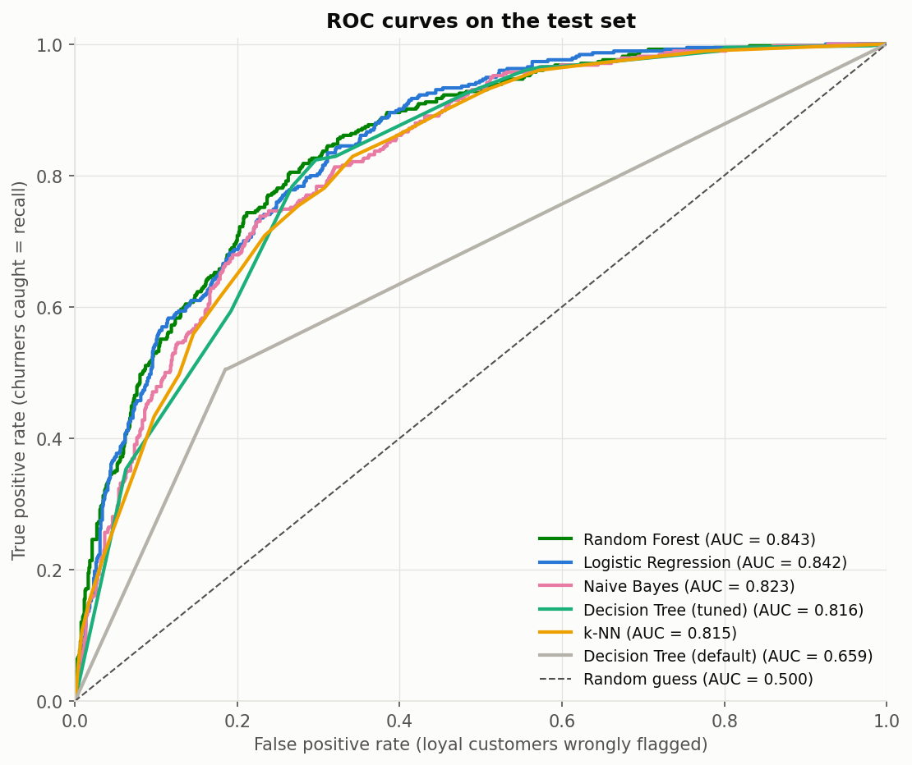
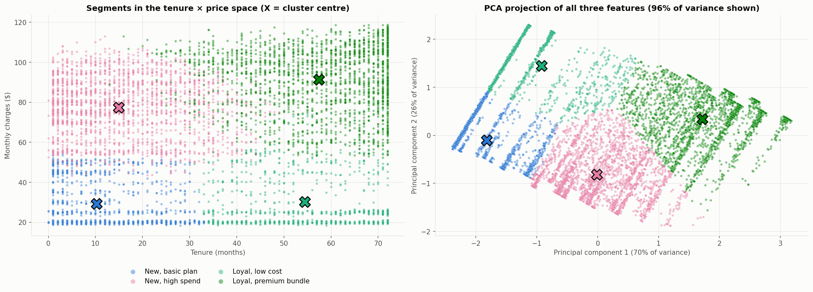
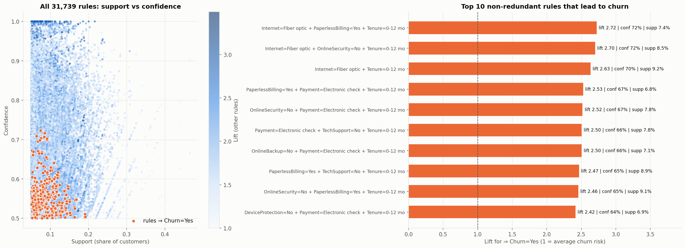

# MSCS 634 – Project Deliverable 3: Classification, Clustering, and Pattern Mining

**Project:** Advanced Data Mining for Data-Driven Insights and Predictive Modeling

**Authors:**
- Pranavi Balakulla
- Sandeep Reddy Banda
- Sowmya Cheruku
- Vineela Reddy Karnatakam

**Dataset:** IBM Telco Customer Churn – cleaned version from [Deliverable 1](https://github.com/pranavibalakulla/MSCS_634_Project_Deliverable_1) (7,043 customers, 26.5% churn)

---

## Repository Contents

```
MSCS_634_ProjectDeliverable_3/
├── Deliverable3_Classification_Clustering_Association_Rules.ipynb   # Notebook with all code, results and visuals
├── README.md                                                        # This file
├── requirements.txt                                                 # Python packages (includes mlxtend)
├── telco_churn_cleaned.csv                                          # Cleaned dataset produced in Deliverable 1
└── Images/                                                          # All charts exported by the notebook
```

**To run:** `pip install -r requirements.txt`, open the notebook in Jupyter and choose *Run All*.

---

## Part A – Classification (predicting churn)

**Models:** Logistic Regression, Decision Tree (default and tuned), k-Nearest Neighbours, Naïve Bayes and Random
Forest. We used a stratified 80/20 split and 5-fold stratified cross-validation, with `class_weight="balanced"` where
the algorithm supports it, because only 26.5% of customers churn.

**Hyperparameter tuning:** `GridSearchCV` on the Decision Tree with 5-fold stratified CV, scored by **F1** for the
churn class (240 combinations, 1,200 fits). We searched `max_depth`, `min_samples_leaf`, `criterion` and
`class_weight`. The best settings were **`max_depth=4`, `min_samples_leaf=40`, `criterion="gini"`,
`class_weight="balanced"`**. Shallower trees underfit (F1 0.577), and deeper trees with tiny leaves overfit: the
train–validation gap reaches 0.49 for the default unlimited tree.



| Model | Accuracy | Precision | Recall | F1 | ROC-AUC |
|---|---|---|---|---|---|
| **Random Forest** | **0.776** | 0.560 | 0.735 | **0.636** | **0.843** |
| Decision Tree (tuned) | 0.746 | 0.514 | **0.783** | 0.621 | 0.816 |
| Logistic Regression | 0.737 | 0.503 | **0.783** | 0.613 | 0.842 |
| Naïve Bayes | 0.738 | 0.505 | 0.751 | 0.604 | 0.823 |
| k-NN | 0.776 | **0.581** | 0.559 | 0.570 | 0.815 |
| Decision Tree (default) | 0.731 | 0.494 | 0.505 | 0.499 | 0.659 |





**Key insights**
- **Random Forest is the best overall model** (F1 0.636, ROC-AUC 0.843). Logistic Regression is nearly as good
  (ROC-AUC 0.842) and fully interpretable.
- **Tuning made a large difference:** the Decision Tree's test F1 rose from 0.499 to 0.621 and its recall from 51% to
  78%.
- **Accuracy alone is misleading:** k-NN ties for the highest accuracy but misses 44% of churners.
- The tuned tree's first questions are **two-year contract? → one-year contract? → fiber optic?** Contract type
  accounts for about 71% of the tree's decisions.

---

## Part B – Clustering (customer segmentation)

**K-Means** on standardised `tenure`, `MonthlyCharges` and `NumServices`. The churn label was **not** used to build the
clusters. **k = 4** was chosen because it has the highest silhouette score (0.427), sits where the elbow curve
flattens, and gives clear business meaning.

| Segment | Share | Profile | Churn rate |
|---|---|---|---|
| New, basic plan | 21% | ~10 months, \$29/month, mostly no internet | 23.9% |
| **New, high spend** | 34% | ~15 months, \$77/month, 70% fiber, 86% month-to-month | **47.0%** (61% of all churners) |
| Loyal, low cost | 14% | ~55 months, \$30/month, mostly 1–2-year contracts | **4.1%** |
| Loyal, premium bundle | 31% | ~57 months, \$91/month, 6.7 services, ≈ \$5,242 lifetime revenue | 15.6% |



**Key insight:** even without seeing churn, segmenting on tenure, spend and engagement separates a group that churns
at **47%** from one that churns at **4%**.

---

## Part C – Association Rule Mining

Each customer was treated as a basket of items, for example `Contract=Month-to-month`, `Internet=Fiber optic`,
`TechSupport=No`, `Tenure=0-12 mo` and `Churn=Yes`. **Apriori** and **FP-Growth** both found the same **10,429 frequent
itemsets** (support ≥ 5%). From these we generated 31,739 rules (confidence ≥ 50%, lift > 1). Of these, **331 lead to
churn**, and 254 remain after removing redundant rules.

| Rule | Support | Confidence | Lift |
|---|---|---|---|
| {Fiber optic, Paperless billing, Tenure 0–12 mo} ⇒ Churn | 7.4% | 72% | 2.72 |
| {Fiber optic, Tenure 0–12 mo} ⇒ Churn | 9.2% | 70% | 2.63 |
| {Electronic check, Paperless billing, Tenure 0–12 mo} ⇒ Churn | 6.8% | 67% | 2.53 |
| {Month-to-month, Fiber optic} ⇒ Churn | 16.5% | 55% | 2.06 |
| {Two-year contract} ⇒ Stay | 23.4% | 97% | 1.32 |
| {StreamingTV, TechSupport} ⇒ {DeviceProtection, StreamingMovies} | 10.0% | 58% | 2.56 |



---

## Practical Relevance and Real-World Applications

All three techniques tell the same story: **new customers on flexible contracts, especially fiber-optic customers
paying by electronic check and without protective add-ons, are the most likely to leave.**

| Finding | Real-world action |
|---|---|
| Churn can be predicted (the best model catches 74–78% of churners) | Score customers monthly and send the highest-risk list to the retention team. Combine with the Deliverable 2 value model to rank by **revenue at risk**. |
| The first 12 months are the danger zone | Run an **onboarding programme**: welcome call, 3-month check-in, early satisfaction survey |
| Fiber-optic customers churn most | Review fiber **service quality and pricing**; offer first-year price locks |
| Two-year contracts retain 97% of customers | Give month-to-month customers **incentives to sign longer contracts** |
| Electronic-check payers churn more | Offer a small credit for switching to **automatic payment** |
| Missing protective add-ons are linked to churn | Include a **free trial of OnlineSecurity / TechSupport** for new internet customers |
| Add-ons are bought in bundles | Build **protection and entertainment bundles** for cross-selling |
| Segments differ greatly in risk (4% vs 47%) | **Target retention spend**: proactive outreach for "New, high spend", VIP care for "Loyal, premium bundle" |

These are associations, not proof of cause and effect, so each action should be A/B tested before rollout. Fairness
(for example, using `SeniorCitizen` as a model input) will be reviewed in Deliverable 4.

---

## Challenges and How They Were Addressed

| Challenge | Solution |
|---|---|
| Class imbalance (26.5% churn) makes accuracy misleading | Stratified split and folds, balanced class weights, and model selection by F1, recall and ROC-AUC |
| The default Decision Tree overfits (train F1 0.996 vs test 0.499) | GridSearchCV over depth, leaf size, criterion and class weight; heatmaps show the overfitting gap closing |
| Feature scales distort k-NN and K-Means distances | `StandardScaler` inside every pipeline and on the clustering features |
| Choosing the number of clusters | Combined the elbow method, silhouette scores and business interpretability |
| K-Means cluster numbers are arbitrary | Named each cluster from its centre (new vs loyal, low vs high spend), so names always match the right group |
| Association rules need categorical items and can explode in number | Binned tenure and charges, created add-on items only for internet customers, set minimum support/confidence/lift, and removed redundant rules |
| Library version differences (`mlxtend` changed `association_rules` arguments; Random Forest scores vary slightly across scikit-learn versions) | Wrote a small wrapper for `association_rules` that works with old and new `mlxtend` versions, and tested the notebook on old and new library versions; Random Forest F1 stayed between 0.63 and 0.64, so the model ranking and conclusions are unchanged |
